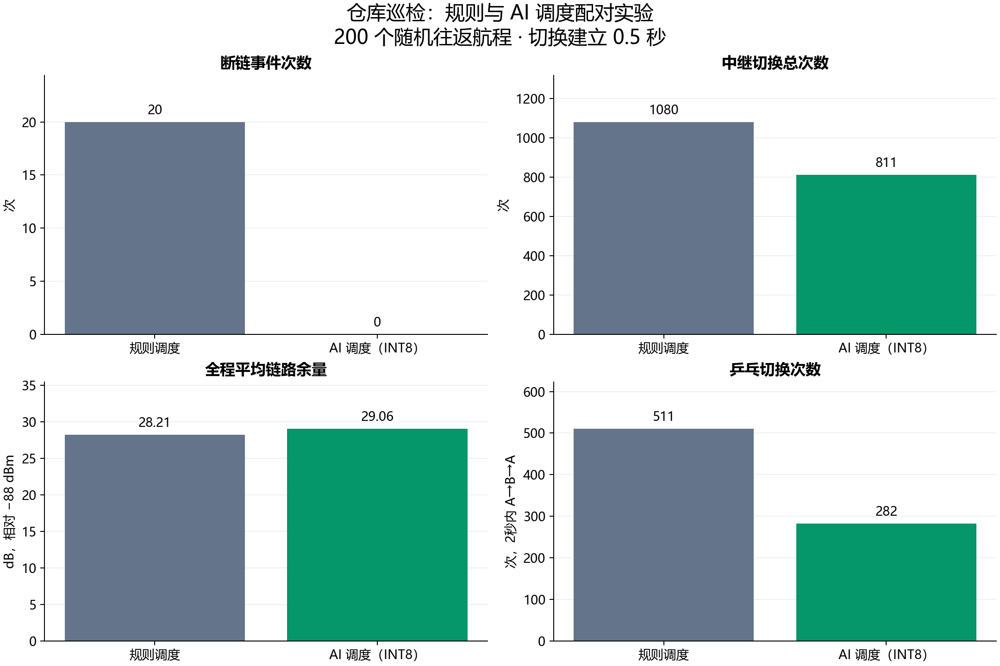
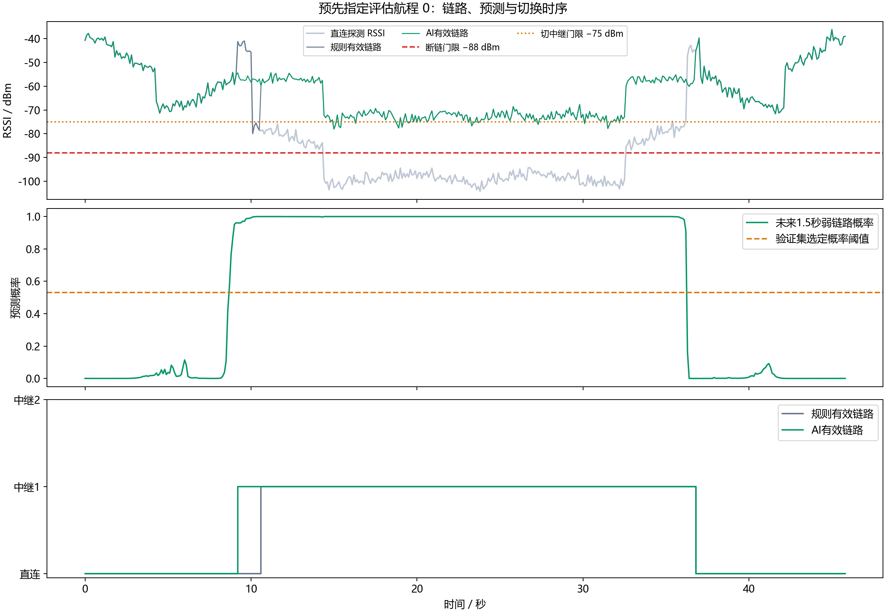

# AI 中继调度实测报告

生成时间（北京时间）：2026-10-06T21:07:33+08:00

必需验收项：全部通过。理想零断链：True。

## 数据与模型

| 划分 | 航程数 | 样本数 | 正例比例 |
|---|---:|---:|---:|
| 训练 | 3500 | 1,564,868 | 53.90% |
| 验证 | 750 | 335,617 | 54.26% |
| 测试 | 750 | 334,616 | 53.94% |

MLP参数量：3,777；验证集选定第16轮，概率阈值0.530。
PyTorch测试集准确率97.7228%，召回率99.1003%，精确率96.7568%。

## 量化验证

Icraft 上板前的 PC 端仿真验证（CPU，batch=1，单线程，预热后1000次均值）

| 模型 | 准确率 | 召回率 | ONNX大小(KiB) | 单次均值(ms) |
|---|---:|---:|---:|---:|
| FP32 | 97.7228% | 99.1003% | 15.55 | 0.01026 |
| INT8 | 97.6466% | 99.1496% | 8.43 | 0.01629 |

INT8召回率下降：-0.0493 个百分点；通过：True。
动态量化包含量化比例计算开销，小模型未必更快；此数值不能推算FMQL30TAI板端延迟。

## 配对调度实验

规则 vs AI（INT8），同一批200个独立随机航程。

| 策略 | 断链事件 | 断链采样点 | 切换次数 | 平均余量(dB) | 乒乓次数 | 中继占用率 |
|---|---:|---:|---:|---:|---:|---:|
| 规则 | 20 | 31 | 1080 | 28.208 | 511 | 47.76% |
| AI | 0 | 0 | 811 | 29.064 | 282 | 53.63% |
| 规则/零延迟 | 0 | 0 | 1487 | 28.464 | 908 | 47.99% |
| AI/零延迟 | 0 | 0 | 954 | 29.106 | 423 | 53.57% |

切换增幅：-24.91%
配对统计：{'mean_outage_event_difference': -0.1, 'paired_bootstrap_95_ci': [-0.155, -0.05], 'one_sided_sign_test_p': 3.0517578125e-05, 'ai_better_voyages': 15, 'ai_worse_voyages': 0, 'tied_voyages': 185, 'bootstrap_repeats': 5000}
验收：{'significantly_fewer_outages': True, 'switch_growth_at_most_50_percent': True, 'ideal_zero_outages': True}

## 验收明细

| 检查 | 通过 |
|---|---|
| dataset_voyages_at_least_5000 | 是 |
| evaluation_voyages_at_least_200 | 是 |
| cpu_latency_repetitions_at_least_1000 | 是 |
| parameters_under_100000 | 是 |
| quantization_recall_drop_at_most_2pp | 是 |
| significantly_fewer_outages | 是 |
| switch_growth_at_most_50_percent | 是 |

## 适用范围

以上结果来自给定几何模型、独立高斯噪声与预先固定的随机种子；不代表真实仓库或NPU上板结果。
默认切换建立0.5秒，期间使用原链路；两组条件相同。零延迟行用于显示该假设对结果的影响。
报告额外给出中继占用率。AI提前进入、延后退出中继会增加空口/中继工作时间，应结合实际电量与吞吐评估。
任何失败项均保留真实结果；不筛选评估航程、不按测试集修改阈值、不将负面实验隐藏。
